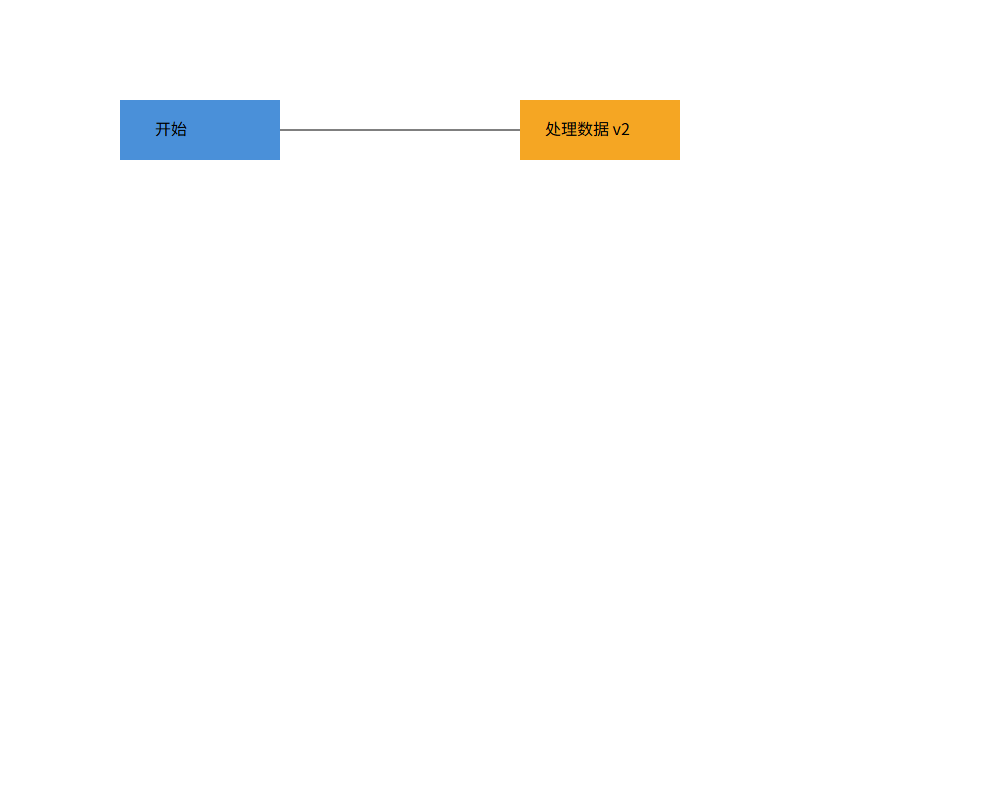

# 第四轮验收记录

本记录对应 phase_cli_1.md 的 Phase 1 范围。功能验收与最终交付分开记录，
没有把已编写但未执行的测试记为通过。

## 自动验收入口

在项目根目录运行：

    npm.cmd run check

依次执行严格类型检查、架构检查、全部测试和构建。
单独执行新增的验收场景：

    npm.cmd run test:acceptance
    npm.cmd run check:architecture

CliProcess.test.ts 使用真实 Node 子进程和 src/main.ts 入口，
在独立临时工作目录输入脚本、检查输出并检查实际 SVG 文件。
入口通过绝对 tsx loader URL 运行，不依赖已有 dist 或工作目录中的 node_modules。
编译后的 dist/main.js 另外进行脚本回放；这两类证据分别记录。

## 命令验收矩阵

下表中的文件均在 tests/；“进程验收”指 CliProcess.test.ts。
文本排版和操作摘要允许与 lab 示例不同，但检查语义、关键属性及规定的错误文本。

| 命令 | 检查内容 | 自动证据 |
|---|---|---|
| init | 默认/指定尺寸、替换文档、重置路径和历史、非法参数不修改状态 | Editor、Persistence、进程验收 |
| read | 无需 init、层级/样式/文字读入、缺 id 警告、失败原子性 | SvgCodec、Persistence、进程验收 |
| save | UTF-8 SVG、显式/默认路径、保存屏障、失败保留文件/路径/历史 | Persistence、进程验收 |
| canvas | 查询不进历史，修改尺寸建立历史屏障 | Editor、进程验收 |
| create | 六种内置图形、可选样式、嵌套 in、未知类型错误 | Editor、Composite、CommandSyntax、进程验收 |
| delete | 删除整棵子树，撤销恢复 id、原父级及顺序 | Composite、HistorySequence、进程验收 |
| move | 浮点增量、容器递归移动、溢出失败原子性 | Editor、Composite、HistorySequence、进程验收 |
| scale | 同时缩放位置和尺寸，容器递归，拒绝非正比例 | Editor、Composite、进程验收 |
| set | 类型几何白名单、公共样式、文字内容、拒绝未知属性 | Editor、InputValidation、进程验收 |
| group | 文档顺序、跨父级、整条操作一次撤销、拒绝祖先/子孙组合 | Composite、HistorySequence、进程验收 |
| ungroup | 子节点原位提升、拒绝顶层容器、撤销恢复 | Composite、HistorySequence、进程验收 |
| addto | 移入末尾、拒绝形成环、撤销恢复父级与顺序 | Composite、HistorySequence、进程验收 |
| front | 移到同级绘制列表末尾，不影响其他父级 | Composite、HistorySequence、进程验收 |
| back | 移到同级绘制列表开头，撤销恢复 | Composite、HistorySequence、进程验收 |
| tree | 全文档/子树、分支结构、内联几何和样式 | Editor、Composite、进程验收 |
| show | 父级、几何、样式、带引号文字 | Editor、进程验收 |
| help | 19 条命令、六种创建语法、与 usage 定义一致 | CommandSyntax、进程验收 |
| undo | 编辑单元、准确恢复每个中间状态、显示类跳过、文档屏障 | Editor、HistorySequence、进程验收 |
| redo | 完整重放、新编辑清空 redo、失败保留 redo | Editor、CommandSyntax、Persistence、进程验收 |

## 通用要求与架构

| 要求 | 证据及范围 |
|---|---|
| TypeScript、面向对象、一类一文件 | 类型检查；AST 检查生产类名与文件名、字段封装 |
| Command 必选 | 每条编辑命令实现 EditCommand，CommandHistory 管理历史；HistorySequence 验证完整往返 |
| Composite 容器与叶子统一 | Shape 多态、Group 递归；Composite/HistorySequence 验证 |
| 依赖方向与 IO 隔离 | AST 检查每条 import/export，含 type-only 引用；Node/XML 仅允许在文档规定位置 |
| 无运行时循环依赖 | 分离类型依赖与运行时依赖，对真实运行时图检查环 |
| 避免按图形标签分派 | 检查 tag 比较和 switch(tag)；允许的两张名字表仍集中在 Router/Factory |
| id 唯一、大小写敏感 | Editor/SvgCodec/Persistence，覆盖后出现的显式 id、重复 id 与根 id 保留 |
| 失败命令不改变状态 | 编辑、解析、文件失败后的文档、redo、路径和原文件检查 |
| 双引号、中文、注释、EOF | Tokenizer/Repl/进程验收，覆盖空文本、转义、CRLF 和末尾无换行 |
| SVG 子文本与转义 | SvgCodec 往返；第四版新增 CR 字符引用、NEL 和 U+2028 保真 |
| 本阶段不实现 box | create box 报 unknown shape type；data-kind 仅作为普通 g 元数据保存 |

AST 检查有明确边界：它验证声明的模块依赖、封装及已列出的 tag 分派写法，
不声称能自动证明整个面向对象设计质量。故意违规的内存样例验证规则会阻止
反向依赖、公共字段、错误类名、运行时循环和绕过静态图的动态加载。
纯类型循环允许存在，但类型引用仍必须遵循层次方向。

## 本轮修复

1. **XML 回车丢失**：字符引用 &#13; 读入后为 CR，原序列化输出裸 CR，
   下一次读入被 XML 行尾规则改成 LF。输出时编码成字符引用，
   连续三次往返保持文本一致。
2. **Unicode 文本被改写**：XML 库的默认归一化采用 XML 1.1 风格，
   会改写 XML 1.0 允许的 NEL/U+2028。解析器明确使用 XML 1.0 的 CR/CRLF 规则。
3. **命令实例重复执行破坏历史**：同一 SnapshotCommand 成功执行两次会重写
   旧历史项的快照。成功执行后拒绝再次 execute；失败的实例仍可修正前置条件后重试；
   正常 redo 继续恢复已保存的结果。

## 保留的边界和待交付事项

- 导入的 transform 原样保留，几何命令按本地坐标操作。
  group/addto 改变父级时会改变继承样式或变换上下文；ungroup 不展开父级变换。
  完整世界坐标重挂接和渲染外观保真不在当前实现范围，不能将相关测试
  宣称为“所有外部 SVG 无损编辑”。本阶段的无 transform 手工组合场景已覆盖。
- 外部 path、CSS style、tspan、百分比几何等明确报不支持，未静默删除。
- 当前命令历史使用完整快照，适合 lab 规模；没有进行大型文档性能承诺。
- 浏览器检查仅覆盖下面记录的流程图，不扩展为所有外部 SVG 的渲染保真承诺。
- 第五轮继续干净环境复现、使用说明核对、远程与 final tag 交付。
  需求文档未给出具体截止日期，最终 tag 必须在课程实际截止时间前完成。

## 本轮实际执行结果

- npm.cmd run check：严格类型检查、43 个生产源码文件的架构检查、
  11 个测试文件的 182 项测试及构建全部通过。
- 编译后的 dist/main.js：在独立 QA 工作目录回放 examples/flowchart.txt，
  仅出现 save 后 undo 的一条预期错误；保存并读回 8 个元素。
- Edge 无界面渲染：使用独立用户数据目录打开上述实际生成的 SVG，
  已查看 1000×800 截图。蓝色“开始”、橙色“处理数据 v2”、水平连线及文字均显示正常，
  move 后 undo 的节点回到同一高度。截图仅对应此示例。

保留的产物：[实际导出的 SVG](qa/round4-flowchart.svg) ·
[Edge 渲染截图](qa/round4-flowchart.png)。截图不在自动测试中做像素比较。

